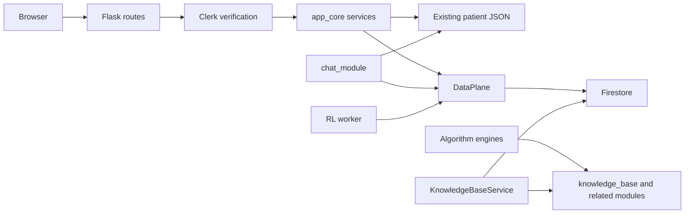

# Architecture

AstroMedica remains a Flask application. Chart mathematics, the combined
algorithm, and the classic chat controller are unchanged. Durable data now
goes through one repository layer.

## Request path

1. Clerk verifies the session when `AUTH_ENABLED` is on. The browser never receives Firestore credentials.
2. `g.user.internal_user_id` comes from `clerk_index/{clerkUserId}`. A caller-supplied user id is not accepted as that mapping.
3. Existing routes still write the patient folder and the legacy per-user collections (`inputs`, `chart_sources`, `algorithm_results`, and the rest).
4. The same operations mirror into the target layout: private identity and source, runs, algorithm outputs, chats, turns, and audit events.
5. Algorithm modules keep importing their current tables. When `KB_SOURCE=firestore`, `KnowledgeBaseService` loads those tables and updates the existing dicts in place.

## Processes

Gunicorn can run more than one worker. Chat snapshots and turns are written under the patient. `POST /send-message` restores a missing in-memory session from `chat_session_index` after checking the owner. The in-memory RL job queue is still the only worker queue. `job_records/{jobId}` stores status for restart visibility.

`/health` is liveness. `/ready` reports the knowledge-base source. With `KB_STRICT=true`, `/ready` returns 503 until Firestore is the loaded source.

## What is not enabled by default

`CHAT_MODE` defaults to `classic`. `RL_HINT_MODE` defaults to `off`. `KB_SOURCE` defaults to `fixtures`, which is an explicit offline source. Production should switch to Firestore only after the migration command has been reviewed. The application does not seed or migrate on startup.
